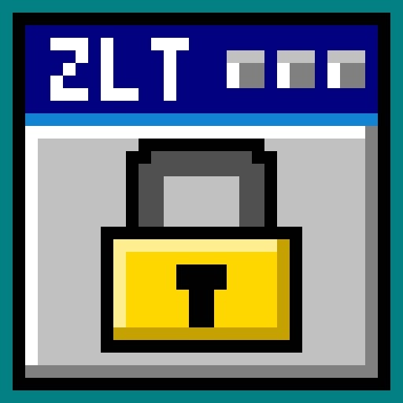

# ZLT X28: VPN and radio control for the ZLT X28 5G router

A Mac app that turns a **ZLT X28** (Tozed Kangwei) 5G router into a router with a
working VPN switch. It installs the VPN engine onto the router once, then gives you
one window to run it, feed it new servers, tune the radio for your SIM, and tell you
what is broken when something is.

No terminal. No config files edited by hand. Every screen explains what it is about
to do before it does it.



---

## What it does

| Screen | What it is for |
| --- | --- |
| **Home** | One switch for the VPN, and one sentence saying what every device on the Wi-Fi is doing right now. |
| **VPN** | Two ways to get out of the country: **Configs** (AmneziaWG/WireGuard files) and **Links** (paste `vless://`, `vmess://`, `trojan://`, `ss://`, `hysteria2://`, `socks://`). Paste, test, pick, switch on, remove. |
| **Radio & bands** | Scans the cells the router can actually hear, then measures band-by-band whether pinning a band is faster. Keeps the winner; puts everything back if it is not. |
| **Router setup** | The one-time job: log in, install the engine, done. Safe to run again. |
| **SIM & carrier** | Reads the SIM and offers **Optimize** — a measured band test using the known fast lanes for IranCell and MCI. |
| **Health** | Press one button; it walks the whole path — router, engine, route, handshake, internet — and names the first thing that failed. |

The point of the Links page is that servers die. You paste in ten, the app speed-tests
each one, marks which are alive, and you pick the fastest. When one dies you remove it
and pick another. Nothing here needs a server or an account.

## Before you start

- A **ZLT X28** on firmware 1.5.x, on its default LAN (`192.168.70.1`).
- Your Mac on the router's Wi-Fi (or plugged into a LAN port).
- The router's **admin password** (the one for its web page). On most X28s it is
  `admin`, but if you changed it, use yours.
- macOS **13 or newer**, Apple Silicon or Intel — the app is universal.

## Install

1. Download `ZLT-X28-v1.1.1-universal.zip` from
   [Releases](../../releases/latest) and unzip it.
2. Drag **ZLT X28** into **Applications**.
3. Open it. The first launch will be blocked because the app is signed ad-hoc, not
   notarised: right-click the app → **Open** → **Open** again. (On macOS 15 and later,
   use **System Settings → Privacy & Security → Open Anyway**.)

The SHA-256 of the zip is published next to it, so you can check the download.

## First run, in order

1. **Router setup** — type the admin password and press the install button. The app
   copies its engine onto the router, gives it a startup hook so it survives a power
   cut, and installs its own SSH key. About a minute. You can repeat it safely.
2. **VPN** — either paste a link, or drop in an AmneziaWG config.
3. Switch it **on**. Wait for the page to say the router is carrying traffic — that is
   the app checking packets actually flow, not just that a process started.
4. **SIM & carrier → Optimize** — optional, but it is the difference between "works"
   and "works at the speed your SIM can do".

## What "on" actually means

The VPN runs **on the router**, not on your Mac. That means every phone, TV and laptop
on the Wi-Fi is covered, including for apps that ignore the Mac's own proxy settings.
The Mac app is only the remote control — you can close it and the VPN keeps running.

Two engines are available, and only one can run at a time:

- **Configs** — AmneziaWG (WireGuard with obfuscation), the most reliable choice if you
  have a working config file.
- **Links** — sing-box, for share links. It is the one to use when your provider gives
  you a link rather than a file.

The app never silently switches engines, and the Home page always names the one that is
carrying traffic.

## Building from source

There is no Xcode project, no package manager and no dependencies to install:

```bash
./fetch-payload.sh     # the sing-box router binary (checked against a known hash)
./ZLTApp/build.sh      # compiles arm64 + x86_64, lipos, ad-hoc signs
```

`build.sh` writes `ZLTApp/ZLT X28.app`. The release workflow does exactly this on a
GitHub macOS runner and attaches the universal zip to the tag, so a release is
reproducible from the repo.

Router-side files live in `awg/`: the `vpn` shell tool the app drives over SSH, the
procd init scripts, and the two small Go helpers (`uapipush`, `dotbridge`).

## Limitations, stated plainly

- Ad-hoc signed, not notarised (no Apple Developer account behind it). Hence the
  right-click-to-open step.
- Built for the X28's stock-rooted firmware. Other Tozed models share the web panel
  but have not been tested.
- A link test starts a short-lived second instance of the engine on the router and
  pulls a 2 MB file through it. That measures the link, not your current traffic, and
  it is safe to test while the VPN is on — but a busy Wi-Fi will make the numbers
  lower than the link can do.
- VPN configs and links are stored on the router under `/data/zltx28/`. Removing a link
  in the app moves it aside on the router rather than deleting it.

## Licence

The app and the router scripts are MIT — see [LICENSE](LICENSE). The bundled
`sing-box` binary is GPL-3.0; see [THIRD-PARTY.md](THIRD-PARTY.md).

---

Made by Morad
